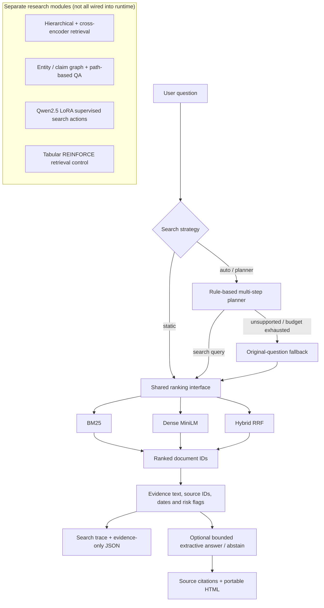

# Agentic Knowledge Engine

**Information architectures · adaptive retrieval · agentic search · retrieval-policy learning**

Part of [Agentic Knowledge Lab](../README.md), a research-engineering repository investigating how language-model-based systems retrieve and work with external knowledge. This workstream owns the **retrieval and agent implementations**; its companion, [KnowledgeBench](../knowledgebench/README.md), owns the benchmark tasks and evaluation.

> **Scope:** A tested research prototype, not a production-ready knowledge agent. The Phase 14 runtime currently integrates BM25, MiniLM dense retrieval, Hybrid RRF and a legacy rule planner. Hierarchical retrieval, claim-graph QA, LoRA SFT and REINFORCE are implemented as **separate research modules**, not interchangeable runtime backends. General answer verification and independent-family generalization are not established.

## Architecture



The planner uses retrieved evidence for subsequent queries; when it cannot proceed, it retrieves against the original question rather than silently returning an empty trace. The base response is **evidence only** (`answer=null`); a separately requested, narrowly templated source extract is **not** independent fact verification.

## Main modules

| Area | Code | Purpose |
|---|---|---|
| Lexical, dense and fusion retrieval | [`retrieval/bm25.py`](retrieval/bm25.py), [`retrieval/vector_math.py`](retrieval/vector_math.py), [`retrieval/hybrid.py`](retrieval/hybrid.py) | BM25, cosine-based vector ranking and reciprocal-rank fusion |
| Hierarchical search and reranking | [`retrieval/hierarchical.py`](retrieval/hierarchical.py), [`retrieval/coarse_to_fine.py`](retrieval/coarse_to_fine.py), [`retrieval/reranker.py`](retrieval/reranker.py) | Document → section retrieval and learned reranking research |
| Knowledge/claim graph | [`graph/schema.py`](graph/schema.py), [`graph/path_search.py`](graph/path_search.py), [`graph/qa.py`](graph/qa.py) | Entity resolution, relational paths, claim/evidence-backed QA |
| Search planning | [`agent/rule_based_planner.py`](agent/rule_based_planner.py), [`agent/state.py`](agent/state.py), [`agent/search_tool.py`](agent/search_tool.py) | Multi-step search, planner state and evidence observation |
| Integrated engine | [`integrated/backends.py`](integrated/backends.py), [`integrated/pipeline.py`](integrated/pipeline.py), [`integrated/verification.py`](integrated/verification.py) | Shared BM25/Dense/Hybrid backend, fallbacks, provenance and restricted source-cited extraction |
| Search-action fine-tuning | [`training/retrieval_policy.py`](training/retrieval_policy.py), [`training/sft_format.py`](training/sft_format.py), [`training/measured_policy_dataset.py`](training/measured_policy_dataset.py) | Typed actions, target-only LoRA SFT formatting and measured-label dataset |
| RL control | [`rl/retrieval_environment.py`](rl/retrieval_environment.py), [`rl/reinforce.py`](rl/reinforce.py), [`rl/shared_policy_protocol.py`](rl/shared_policy_protocol.py) | Gold-isolated reward environment, tabular policy-gradient research and common policy contract |

## Run the project

Run these commands **from the repository root**, with Python 3.12 and [`uv`](https://docs.astral.sh/uv/) installed:

```bash
uv sync --all-groups
uv run pytest
uv run ruff check .

# CPU-only BM25 evidence trace; no model-weight download
uv run python scripts/run_phase14_integrated_demo.py --backend bm25 --strategy static --top-k 3

# Show source-cited extraction when supported, otherwise abstain
uv run python scripts/run_phase14_integrated_demo.py --backend bm25 --strategy static --top-k 5 --extractive-answer

# Exercise the planner's original-query fallback on unsupported intent
uv run python scripts/run_phase14_integrated_demo.py --strategy auto --question "Where do exhausted failed jobs go?"

# Optional: use pretrained MiniLM for real vector / fusion ranking
uv run python scripts/run_phase14_integrated_demo.py --backend hybrid --strategy static --top-k 5

# Standalone inspectable HTML evidence report (no hosted service needed)
uv run python scripts/run_phase14_html_demo.py --output phase14_demo.html
```

The `hybrid` option loads MiniLM weights when needed. The default BM25 demo and CI smoke tests do **not** require a GPU or model download. Without Codespaces, see the [CI runbook](../docs/operations/phase14-runbook.md) and download the `phase14-evidence-demo` artifact from a successful [GitHub Actions run](https://github.com/ivedantsharma/agentic-knowledge-lab/actions).

## Measured research highlights

| Experiment | Observed development result | What it does **not** prove |
|---|---|---|
| [EXP-121 fixed retrieval](../docs/experiments/EXP-121-fixed-retriever-comparison-result.md) | Hybrid MRR@3 **0.8333** vs BM25 **0.8194** on 12 inspected routing questions | The six-family bootstrap interval for the difference includes zero; no established universal win |
| [EXP-122 representations](../docs/experiments/EXP-122-knowledge-representation-ablation-result.md) | Claim-graph QA recovered complete evidence paths on **4/4** graph-derived tasks; flat BM25 **1/4**, hierarchy **2/4** | A pure causal graph-representation advantage; the systems/rankers differ |
| [EXP-123 planning](../docs/experiments/EXP-123-static-vs-agentic-search-result.md) | Rule planner recovered full support on **4/5** previous multi-hop tasks, but failed before searching on one unfamiliar intent | Robust general-purpose agent planning or a same-budget win over static Top9 |
| [EXP-124 learned policies](../docs/experiments/EXP-124-learned-policy-comparison-result.md) | Implemented common BM25 action / state / STOP protocol for future retrained SFT and RL | Direct SFT-vs-RL superiority; that experiment stopped **inconclusive** |

**Phase 14 reality check:** On the known ten-question hard benchmark, the integrated auto strategy needed fallback on **10/10** tasks. The narrow source-extractive prototype correctly answered only **2/6 answerable** cases. See the [measured integration report](../docs/research/phase14-integrated-development-benchmark-result.md). These are valuable failure findings, not production reliability numbers.

## Research documentation

- [Phase 14 architecture (HLD)](../docs/architecture/phase14-hld.md) and [implementation (LLD)](../docs/architecture/phase14-lld.md)
- [Phase 11 LoRA SFT review](../docs/research/phase11-final-review.md) and [Phase 12 RL review](../docs/research/phase12-final-review.md)
- [Phase 13 final research review](../docs/research/phase13-final-review.md)
- [Phase 14 engineering handoff](../docs/research/phase14-integration-handoff-review.md)
- [KnowledgeBench evaluation workstream](../knowledgebench/README.md)

**Integrity:** Benchmark gold/expected answers belong to the evaluator, not the retrieval policy. Fictional teaching-only metrics are excluded from the observed results linked here.
