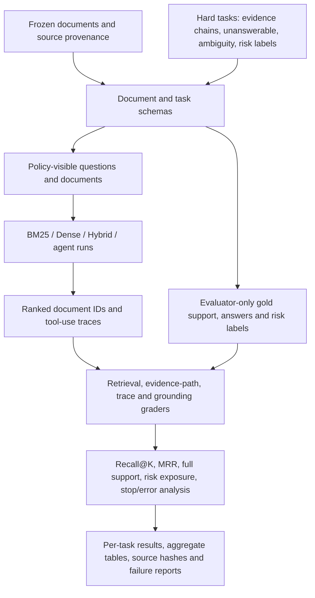

# KnowledgeBench — Hard Knowledge & Agent Evaluation

**Retrieval evaluation · multi-hop evidence · agent traces · robustness and failure analysis**

The evaluation workstream of [Agentic Knowledge Lab](../README.md). KnowledgeBench tests how systems retrieve external evidence, navigate multi-step searches, handle misleading sources and record tool-use failures. The companion [Agentic Knowledge Engine](../knowledge_engine/README.md) implements the systems under test.

> **Scope:** Reproducible **development-scale** evaluation infrastructure. The existing questions and evidence families have been inspected during research; they are not untouched external holdouts. Retrieval coverage and source-risk exposure are **not** generated-answer accuracy, calibrated abstention or measured prompt-injection resistance.

## Evaluation architecture



**Leakage boundary:** gold support IDs and expected answers are used by graders **after** retrieval or a policy run; they are not passed into the retriever, planner or learned policy. Source hashes make the input versions auditable.

## Main modules

| Area | Code | Responsibility |
|---|---|---|
| Typed documents and hard tasks | [`documents/v2_schema.py`](documents/v2_schema.py), [`tasks/v2_schema.py`](tasks/v2_schema.py) | Source types, effective dates, evidence chains, answerable/unanswerable, distractor, contradiction, stale and ambiguity labels |
| Ranking metrics | [`metrics/`](metrics/), [`evaluation/retrieval_evaluator.py`](evaluation/retrieval_evaluator.py), [`evaluation/phase13_retriever_comparison.py`](evaluation/phase13_retriever_comparison.py) | Recall/precision, MRR, complete support, paired retriever comparison and family-cluster bootstrap |
| Hard-evidence robustness | [`evaluation/phase13_hard_robustness.py`](evaluation/phase13_hard_robustness.py), [`evaluation/v2_audit.py`](evaluation/v2_audit.py) | Conditional distractor/contradiction/stale exposure and ambiguity-candidate coverage |
| Multi-hop and claim paths | [`tasks/multihop_schema.py`](tasks/multihop_schema.py), [`evaluation/evidence_path_grader.py`](evaluation/evidence_path_grader.py), [`evaluation/phase13_representation_comparison.py`](evaluation/phase13_representation_comparison.py) | Evidence-chain evaluation across flat, hierarchical and claim-graph systems |
| Agent behavior and grounding | [`runs/agent_trace_schema.py`](runs/agent_trace_schema.py), [`evaluation/agent_trace_grader.py`](evaluation/agent_trace_grader.py), [`evaluation/agent_grounding_grader.py`](evaluation/agent_grounding_grader.py) | Tool calls, repeated searches, premature STOP, source support and answer comparison |
| Adversarial pair grading | [`evaluation/prompt_injection_grader.py`](evaluation/prompt_injection_grader.py) | Compare supplied clean/injected model outputs; the **EXP-125 study only inventoried** existing pairs rather than running a model attack |

## Benchmark data and evaluation scope

The main hard-v0 dataset contains **22 documents** and **10 previously inspected challenge questions** (**6 answerable**, **4 unanswerable**, including **2 ambiguity cases**).

- [Frozen hard documents](../data/processed/knowledgebench_v2_hard_documents_v0.json)
- [Hard task annotations](../data/processed/knowledgebench_v2_hard_tasks_v0.json)
- [Previously inspected paired routing questions](../data/processed/phase10_routing_pairs_v0.json): 12 questions in six evidence families for the fixed-retriever comparison
- [Existing Phase 9 injection-pair inventory](../data/processed/phase9_prompt_injection_pairs_v0.json): example cases, **not proof of successful attack or defense**

The graders report **retrieved** misleading evidence separately from **answers generated using** that evidence. A retriever returning nonempty results on an unanswerable question is **not** automatically an abstention failure.

## Reproduce the evaluations

Run from the **repository root** with Python 3.12 and [`uv`](https://docs.astral.sh/uv/):

```bash
uv sync --all-groups
uv run pytest
uv run ruff check .

# Corpus hashes, task/family counts and exposure checks (no model download)
uv run python scripts/run_phase13_campaign_inventory.py

# Hard-robustness grader unit tests
uv run pytest tests/test_phase13_hard_robustness.py

# CPU-only integration benchmark on the existing 10 questions
uv run python scripts/run_phase14_integrated_benchmark.py

# Full pretrained MiniLM comparisons (may download model weights)
uv run python scripts/run_phase13_fixed_retriever_comparison.py
uv run python scripts/run_phase13_hard_robustness_comparison.py
```

The model-based scripts use a frozen `sentence-transformers/all-MiniLM-L6-v2` model. CI tests use fake encoders where appropriate; a green unit test **is not** a fresh pretrained-model experiment. Without Codespaces, use the [GitHub Actions runbook](../docs/operations/phase14-runbook.md).

## Measured results and failure cases

| Study | Observed result on inspected development material | Important qualification |
|---|---|---|
| [EXP-120 data provenance](../docs/experiments/EXP-120-campaign-provenance-inventory-result.md) | Audited source fingerprints, task families and split exposure | Source audit, **not** predictive accuracy |
| [EXP-121 retrieval baselines](../docs/experiments/EXP-121-fixed-retriever-comparison-result.md) | At K3, BM25 / Dense / Hybrid all achieved **1.0000 mean gold-support recall** on 12 routing questions; Hybrid MRR@3 **0.8333** | Saturated, inspected tasks; Hybrid–BM25 difference not convincingly established |
| [EXP-122 representations](../docs/experiments/EXP-122-knowledge-representation-ablation-result.md) | Full evidence recovered: graph **4/4**, hierarchy **2/4**, flat BM25 **1/4** | Four graph-derived questions and different system/ranking paths |
| [EXP-123 search behaviors](../docs/experiments/EXP-123-static-vs-agentic-search-result.md) | A rule planner failed **before the first search** on an unfamiliar intent | No universal planner advantage or matched-budget answer comparison |
| [EXP-125 hard robustness](../docs/experiments/EXP-125-hard-robustness-result.md) | Hybrid **Recall@5 = 0.8889**, full support **5/6** answerable tasks; at K5, labeled stale **3/3**, contradictory **2/2**, distractor **2/2** exposure | Conditional denominators; retrieved risks do **not** establish wrong answers |
| [Phase 14 integrated diagnostics](../docs/research/phase14-integrated-development-benchmark-result.md) | Narrow source extraction correct **2/6** answerable questions; abstained **4/4** unanswerable; auto planner fell back **10/10** | Ten known tasks, unequal search budgets, narrow templates; no calibrated safety claim |

The main research lesson is that **better evidence recall can coincide with greater exposure to stale or contradictory context**. We measure these dimensions separately rather than reporting a single misleading “agent accuracy” number.

## Research records and limitations

- [Phase 13 final review](../docs/research/phase13-final-review.md): experiment ledger, uncertainty, negative results and limits
- [EXP-124 learned-policy comparison](../docs/experiments/EXP-124-learned-policy-comparison-result.md): a validated common SFT/RL execution contract but **no valid direct trained-model comparison**
- [Phase 14 integration handoff](../docs/research/phase14-integration-handoff-review.md): tested prototype and remaining research goals
- [Knowledge Engine implementation](../knowledge_engine/README.md): systems whose outputs these metrics evaluate

**Not claimed:** robust prompt-injection defense, independent unseen-family generalization, reliable answer verification, model-driven abstention, or SFT/RL superiority. The repository contains a separately labeled [fictional EXP-124 teaching example](../docs/experiments/EXP-124-illustrative-hypothetical-simulation-NOT-RESULTS.md); **its invented numbers are not research results and are excluded above**.
